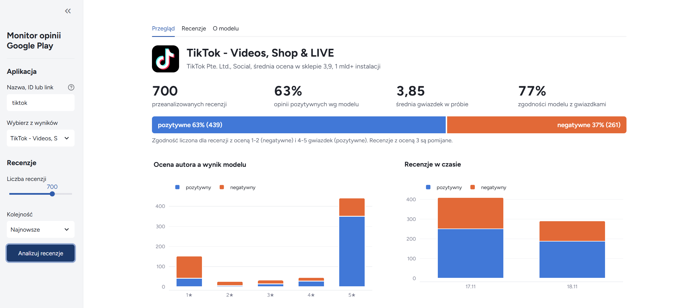
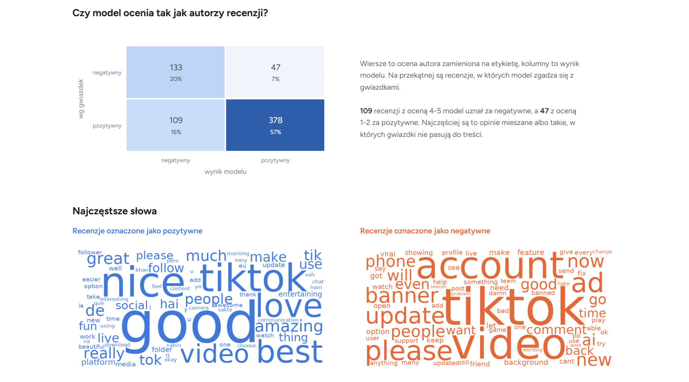
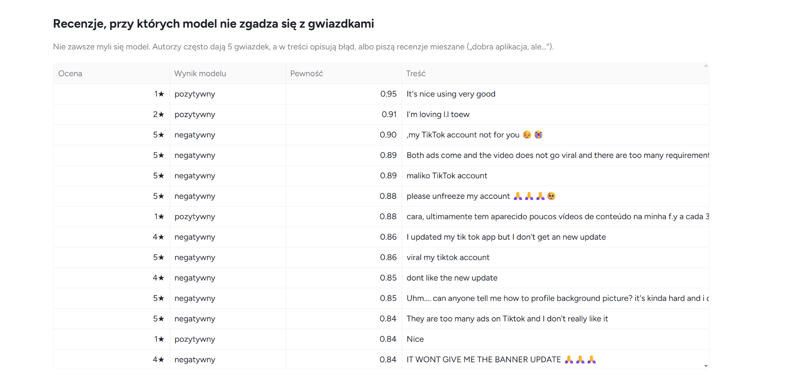

# Google Play Review Sentiment Monitor

A Streamlit app that fetches reviews of **any Google Play app** live and classifies their sentiment (positive or negative) with a machine learning model trained on 12k+ labelled reviews.

  



<!-- If deployed on Streamlit Community Cloud: **[▶ Live demo](https://...)** -->

> The app interface is in Polish; the model works on English reviews.

## Features

- **Search apps** by name, Play Store ID or link (the main app, e.g. TikTok, is ranked first).
- Choose **how many reviews** to fetch and the order (newest or most relevant).
- See the **sentiment breakdown**, star rating vs. model prediction, and sentiment over time.
- **Live model validation**: predictions are compared with the stars the authors gave.
- **Word clouds** for positive and negative reviews.
- Inspect reviews where the **model disagrees with the stars**.
- Filterable review table with **CSV export**.
- A tab with model metrics and the confusion matrix.





## Model

| | |
|---|---|
| **Training data** | [Google Play Store Reviews](https://www.kaggle.com/datasets/prakharrathi25/google-play-store-reviews) (Kaggle), 12,495 reviews rated 1–5 |
| **Labels** | 1–2 stars → negative, 4–5 → positive, 3 → dropped |
| **Features** | TF-IDF on unigrams and bigrams |
| **Models compared** | Logistic Regression, Multinomial Naive Bayes, Linear SVM |
| **Selection** | best macro F1; on a tie, the simpler model |
| **Result** | ~86% accuracy and macro F1 on the test set |
| **Live check** | 77% agreement with star ratings on 700 recent TikTok reviews (Nov 2026) |

The Kaggle dataset was collected with the same `google-play-scraper` library that the app uses, so the training data and the live data share the same structure (`content`, `score`).

## Tech stack

Python · pandas · scikit-learn · google-play-scraper · Streamlit · WordCloud · Jupyter

## Project structure

| Path | Description |
|---|---|
| `src/preprocessing.py` | loading, text cleaning, stars → labels |
| `src/train.py` | training and comparing models; saves the model, metrics and confusion matrix |
| `src/scraper.py` | app search and review fetching |
| `src/predict.py` | sentiment prediction for fetched reviews |
| `app.py` | Streamlit dashboard |
| `notebooks/01_eksploracja.ipynb` | exploratory analysis of the training data |
| `models/metrics.json` | training results |

## How to run

```bash
python -m venv .venv
.venv\Scripts\activate          # Windows  (Linux/macOS: source .venv/bin/activate)
pip install -r requirements.txt
```

1. Download the dataset from Kaggle and put `reviews.csv` in `data/raw/`.
2. Train the model: `python -m src.train`
3. Start the app: `streamlit run app.py` (it opens at http://localhost:8501)

## Limitations

The gap between test accuracy (~86%) and live agreement (77%) is partly the model and partly the data. Many reviews have stars that don't match their text (e.g. 5★ with a bug report), and some are not in English.

- English reviews only (data is fetched from the US store).
- A bag-of-words model struggles with sarcasm and mixed opinions.
- The training data covers mostly productivity apps, mainly from 2020.
- Possible next step: a transformer model (e.g. DistilBERT) for better handling of context.